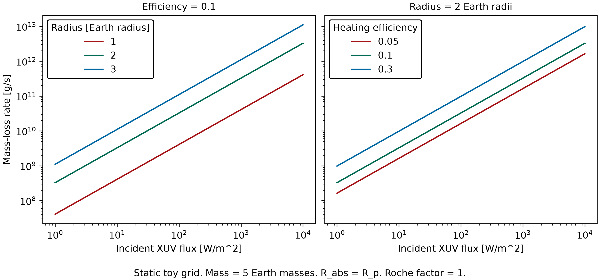

# TestingPhotoevaporation

How does the energy-limited escape rate scale with planet radius, heating efficiency, and incident XUV flux? We explore that question with a synthetic grid and TDpy's shared, unit-aware mass-loss calculation.

From the checkout root, source `scripts/set_repository_path.sh` to set `TESTINGPHOTOEVAPORATION_PATH` in the current shell. The ignored `data/` and `visuals/` directories are available for local inputs and generated figures.

## Static escape calculation

Our [notebook](examples/energy_limited_escape.ipynb)
calls `run_example` in [the example script](scripts/energy_limited_escape.py), which
evaluates TDpy's unit-aware `energy_limited_mass_loss` helper. The planet mass stays
at five Earth masses. We vary radius from one to three Earth radii, heating
efficiency from 0.05 to 0.3, and incident XUV flux from 1 to 10,000 W/m^2. The
absorption radius equals the planet radius and the Roche factor is one.



The [interactive figure](examples/visuals/energy_limited_escape_white_20261024_010714.html)
uses the same 720 calculated rates as the CSV. Its two panels show
fixed-efficiency and fixed-radius slices of the nine radius-efficiency
combinations. These curves represent the specified synthetic inputs.

Install the pinned TDpy revision and the example's dependencies from this checkout.
The notebook's interactive figure additionally requires Bokeh 3.10 or later.
Select that same Python environment as the notebook kernel.

```bash
python -m pip install -r requirements.txt 'bokeh>=3.10' ipykernel
python scripts/energy_limited_escape.py --bokeh
python scripts/energy_limited_escape.py --typefileplot pdf --typeplotback dark
```

The CLI writes timestamped outputs under `visuals/`. The notebook writes directly
under `examples/visuals/`. Each call returns the table and output paths. Existing
outputs are never replaced. PNG is the default at 300 dpi. PDF and white/dark
themes are supported, and `--bokeh` adds a self-contained HTML version. The
calculation evaluates 720 static input combinations without time integration.
Plot generation and optional HTML serialization add runtime.

## Assumptions and limits

The rate is absorbed power divided by binding energy per unit mass,
$\dot M=\eta\pi R_{\rm abs}^{2}F_{\rm XUV}R_p/(GM_pK)$.
The energy-limited approximation and Roche correction are discussed by Erkaev
et al. (2007), *A&A*, 472, 329, DOI `10.1051/0004-6361:20066929`.

Mass, radius, flux, absorption altitude, and heating efficiency are fixed inputs.
There is no radiative-cooling model, hydrodynamic solution, atmospheric supply,
or evolution of stellar irradiation or planet structure. The curves show the
assumed flux, efficiency, and radius scalings. They do not establish atmospheric
lifetimes, a stripped-envelope fraction, or a radius-valley prediction.

Run `python -m pytest -q` to check the shared-helper calls, numerical table,
static themes and formats, Bokeh data parity, and protection of previous outputs.